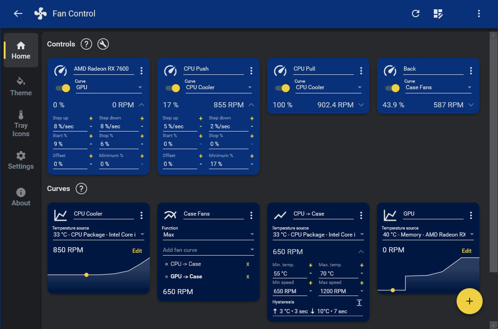
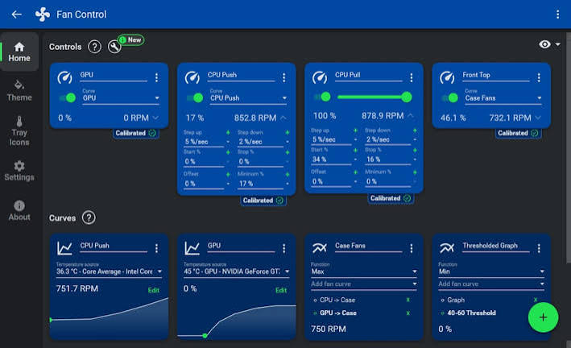
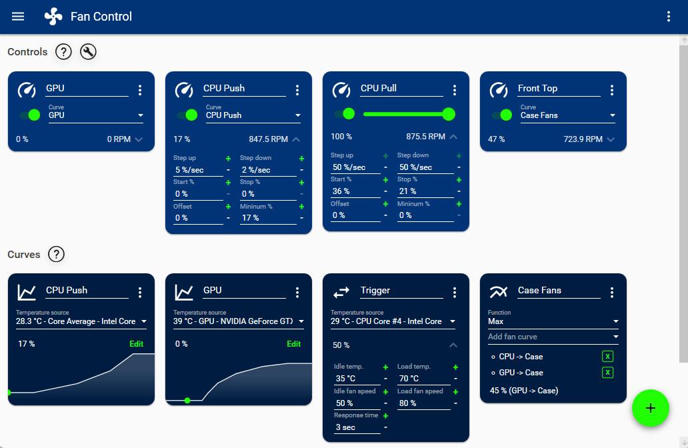

# Fan Control PC

Fan Control PC is a free Windows program that sets fan speed while the system is running. You do not reboot into the BIOS to try a new curve. The same window covers the CPU fan, case fans, an AIO, and GPU Fan Control for the graphics card.

People search fancontrol by rem0o because that is the author name attached to fancontrol software. This page is that Windows app. It is not a laptop vendor utility and not a BIOS screen.

A curve maps a temperature to a percent. A profile stores a set of curves, such as a quiet set and a gaming set. You can load one without rebuilding the graph.

## Warning

Fan speed is a hardware limit, not only a slider. A curve that holds fans at a stop while the CPU is hot can shut the PC down. Start from a curve that already moves air, then lower it.

The sensor path uses a signed driver so the app can read the board. Install that driver from the official package. An old build that still ships an unsigned ring driver is the one security tools flag. Update rather than adding an exclusion for a random file.

If a fan is the only cooler on a GPU, do not test 0% on that header while a game is running. GPU Fan Control should keep a floor until you know the card's own limit.

A case fan on a hub can spin while the motherboard header reports nothing. Trust the tach wire you actually connected, not the label on the box.

Stop the test if a cable ticks against a blade. Calibration is loud on purpose. It is not a burn-in.

After a curve change, watch the temperature for a few minutes at idle and again under load. A quiet curve that climbs without end is too low. Raise the warm end before you save it as the daily profile.

## What it can do

The live list shows temperature and RPM next to the control that drives each fan. You can change a percent and hear the result immediately.

Sources include the CPU, the GPU, the motherboard, and drives. One fan can follow a mix of those sensors: the maximum, the minimum, or the average. The usual mix is the maximum of CPU and GPU, so the case fans rise when either chip is hot.

GPU Fan Control is the same idea pointed at the graphics card. The card's temperature is the source. The card's fan header, or a case fan you assign to that temperature, is the output. It does not replace the card's own safety limit.

Drive temperature is a valid source when a hard disk sits in a hot bay. It is a poor source for the CPU fan. Pick the sensor that actually heats the part the fan cools.

An AIO pump should stay on a flat percent. A curve that stops the pump at idle is how a loop overheats with the fans still spinning. Leave the pump off the graph and put the radiator fans on the CPU sensor.

The sensor record the list is built from is [Sensor.cs](Sensor.cs). Board access for those readings goes through [PawnIo.cs](sensor/PawnIo.cs).

## Main Features

- A first-run setup that asks which controls you want to use.
- Profiles you can save, edit, and load.
- A graph curve, plus simpler shapes when a graph is more than you need.
- Mix of curves or sensors by max, min, or average.
- Steps, start percent, stop percent, response time, and hysteresis.
- A theme and accent color for the window.

The graph points live in [graph.rs](curve/graph.rs). A straight ramp, when you do not want knots on a graph, is [linear.rs](curve/linear.rs). A fan row in that graph is [fan.rs](fans/fan.rs).

| Profile | What it is for |
| --- | --- |
| Quiet | Low speed until a sensor crosses a warm point |
| Balanced | The everyday curve after calibration |
| Gaming | Earlier rise so the GPU does not sit at its limit |
| Custom | A graph you drew and saved under your own name |

## Features

Calibration runs the fan across its range and records the percent where it actually starts, and the RPM the header reports. A header with no RPM wire still accepts a percent. It just cannot show speed.

0 RPM stop is optional. The fan stays off below a temperature you set, then starts at the percent calibration found. Do not enable stop on a pump or on a GPU blower unless you have tested it.

Hysteresis keeps the fan from chasing a one-degree wobble. Response time is how fast the percent is allowed to change. Avoid points are percents you skip because they rattle.

fan control curves are stored with the profile, not in the BIOS. Clearing a profile does not clear the BIOS curve. After you exit the app, the board may return to its own control unless you set the app to stay running.

Manual mode holds a percent you type. It ignores the graph until you switch that header back to a curve. Use it to find a speed that is quiet, then copy that percent onto the graph at the current temperature.

Auto mode gives the header back to the board or the card. That is the right mode for a fan you have not calibrated yet.

## Plugins

Plugins add sensors and controls the base scan does not see. A plugin is a small library dropped into the plugins folder. The brands people add most often are Corsair, NZXT, ASUS, and an HWiNFO feed.

A plugin that fails to load does not stop the rest of the app. The CPU and GPU rows still work. Restart after you add a file. If the row is still missing, the device is off, asleep, or not in that plugin's list.

GPU Fan Control for Nvidia and AMD does not require a third-party plugin. Those cards are read through their own interfaces. Intel graphics is a separate case and may need the vendor plugin before a fan row appears.

Install one plugin at a time. A bad file is easier to remove when it is the only new one. Keep the plugin next to the app, not in a random download folder.

If two plugins both offer the same cooler, use one. Two writers on one pump is the same fight as two fan programs.

## Issues and hardware compatibility

If a header never appears, the board sensor layer did not see it. Update the app before you chase a BIOS setting. Many missing-sensor reports were the old unsigned driver, which current builds no longer ship.

A control can show up and still refuse a write. Some laptop EC chips ignore Windows and keep the OEM curve. In that case the app can display RPM and still not own the fan. That is a limit of the laptop, not a broken curve.

External hubs and lighting controllers often need the matching plugin. The header on the motherboard and the header on a hub are different devices even when the fan is the same.

A laptop that hides its fans in an embedded controller will look empty here. The OEM app is then the one that owns those fans. Fan Control PC can still show CPU and GPU temperature.

Desktop boards are the case this app is built for. A header labeled CPU_FAN, CHA_FAN, or AIO_PUMP should show up after the sensor driver is in place.

## Troubleshooting

| Symptom | What to check first |
| --- | --- |
| No fans listed | The sensor driver is missing or blocked |
| RPM stays at zero | The fan has no tach wire, or it is stopped |
| Percent changes, noise does not | Another tool, or the BIOS, still owns that header |
| GPU fan ignored | The card is at 0% by its own firmware until a hotter point |
| App will not open | A second copy is already in the tray |

Quit other fan tools before the first calibration. Two programs writing the same header fight, and the curve looks random.

fancontrol not detecting fans is usually the driver or a header the board never exposed. Rescan after the driver install. A USB fan with its own dongle will not appear as a motherboard header.

The grid in that list is headers grouped by CPU, case, AIO, and GPU. A row with RPM and no control means the app can see the fan and cannot write it yet.

## Repo structure

The tree is split so a curve, a sensor, and a fan header are not the same file.

- `curve` holds graph and ramp shapes.
- `sensor` holds the readings those shapes follow.
- `gpu` holds the graphics card path used for GPU Fan Control.
- `fans` holds header and controller code.
- `ui` holds the window pieces.
- `config` holds startup and the hardware bridge.

The process entry is [main.rs](main.rs). The command line next to it is [cli.rs](config/cli.rs). The bridge that asks the board for controls is [HardwareManager.cs](config/HardwareManager.cs).

`curve` answers what percent a temperature should produce. `sensor` answers what the temperature is. `fans` is the header that receives the percent. `gpu` is the graphics card, both as a sensor and as a fan.

Keep those apart when you read the tree. A change to the graph shape should not be how you add a new board.

## Developer information

Build files at the root name the projects. They do not contain your curves. The crate file is [Cargo.toml](Cargo.toml). The Windows sample settings are `win.toml`. The check scripts are [ci.yml](ci.yml) and `nightly.yml`.

A curve point is a temperature and a percent. The editor that draws those points is [graph.rs](ui/graph.rs). That file is the window. The file under `curve` is the data.

Do not treat a failed script as a broken fan. The packaged build is what you run on the PC. This tree is the map of how a scan, a mix, and a write fit together.

## FAQ

### Does calibration spin the fans to full speed?

Yes. It has to find the start percent and the top of the range. Do it once, with the case open if a cable might hit a blade, and not while a disk-heavy task is running.

### Can two sensors drive one fan?

Yes. Pick max, min, or average. Max of CPU and GPU is the mix that keeps case fans honest when only the graphics card is busy.

### Will 0% stop a GPU fan?

Only if the card allows it. Many cards keep their own floor until a temperature. GPU Fan Control can request a lower percent. The card firmware can ignore that request until it is hotter.

### Can the app start with Windows?

Yes. Leave it running in the tray, or use the startup option, so the curve is applied before a game launches. A curve that only exists while the window is open will not protect a boot into a heavy load.

The service-style start is for a machine that should follow a profile even when nobody has signed in. Use that on a bench PC, not as the first thing you enable on a laptop.

## Libraries used

Temperature and fan headers come from the sensor layer. Nvidia fan percent and GPU sensors go through [NvApi.cs](gpu/NvApi.cs) and [NvidiaGpu.cs](gpu/NvidiaGpu.cs). AMD cards go through `AtiAdlxx.cs` and [AmdGpu.cs](gpu/AmdGpu.cs).

The tray icon and the side list are [tray.rs](ui/tray.rs) and `drawer.rs`. English UI strings sit in `i18n.toml`. Saved profile shape is described by `settings.toml`.

Nothing in that set replaces the confirm you do on the graph. A detected header is not controlled until a curve is assigned and the control is set to manual.

Motherboard fans and GPU fans share the window and not the write path. The board header uses the sensor driver. The graphics card uses the vendor interface. If one side works and the other does not, update that side only.

A mix node sits between them. It does not talk to hardware. It only picks max, min, or average and hands one number to the curve.

## Acknowledgements

The sensor names you see are the same chips Windows and the board already expose. The author people mean by fancontrol by rem0o publishes the Windows build. This tree shows the curve, the GPU path, and the fan headers side by side. It does not replace that build.

Paired fans on one radiator can share a curve. They do not have to share a header. Calibrate each header. One of them often starts at a higher percent.

Name the profile after the room, not after a date. "Night" and "Render" are easier to load than a string of numbers.

## Get the app

### Windows

- Windows 10 or Windows 11 on the PC whose fans you want to tune.
- A sensor driver install on first launch, from the official package.
- A fan header the board or the GPU actually exposes.

fancontrol windows and fan control for windows 10 are the same desktop app. There is no separate phone build, and there is no Linux package for this Windows tool.

### Packaged build

Download one package. Portable zip or installer, from the publisher. One button.

The current version stamp shipped with the release notes is [version.json](version.json). A repack that adds a toolbar is not this program.

On first start, let the setup scan, then calibrate the headers you intend to use. Assign GPU temperature to the GPU fans before you assign it to every case fan.

fan control portable is the zip. You can keep it on a USB stick for a bench, as long as the sensor driver is allowed to install on that PC. The installer is the better choice when you want a start menu entry and a clean uninstall.

Do not mix a nightly file with an old plugin folder. Point the new build at a fresh folder, then copy only the plugins you still need.

### Uninstall

Exit the tray icon first. If you only close the window, the app can still hold the headers. Then remove it from Windows. If you used the zip, delete the folder after you exit.

Fans should fall back to the BIOS curve after the app is gone. If a header stays stuck, reboot once so the board takes control again.

Delete leftover profiles only after you have the BIOS curve you want. A profile file is not a driver. Removing it does not remove the sensor driver.

If uninstall still leaves a tray icon, reboot before you delete the folder. A running copy will lock the files.

## Screenshot

The main view is the graph and the fan list together. The graph is percent against temperature. The list is the live RPM.

A flat line on the graph is a fixed percent. A rising line is a curve. If the live percent does not follow the line, the header is still on auto or another program owns it.

Hover a point to read its temperature and percent. Dragging a point past its neighbor is how a curve folds back on itself. Keep each point warmer than the one on its left.

The sensor editor is where a curve picks its source. You can point one fan at the GPU, another at the CPU, and a third at the mix. The editor does not rewrite the BIOS.

A GPU row that stays at the card's own floor is still a successful read. It means the card, not the curve, is deciding the minimum.

Save the profile before you close the window the first time. An unsaved graph is gone when the app exits. The BIOS curve is what you get back until you load the profile again.

The grid and the graph are the same fans. The grid is for scanning many headers. The graph is for one curve at a time.

## Related Questions

### Can I trust Fancontrol?

The Windows build from the publisher is the one to run. It is free fancontrol software, used widely, and the current sensor path is a signed driver rather than the old unsigned one. Do not turn security off for a repack. If the file is not the publisher package, do not run it.

### What does Fancontrol do?

It reads temperatures and fan speeds, then writes a percent to the headers you chose. Fan Control PC does that with curves and profiles. GPU Fan Control is the same window pointed at the graphics card, not a second download.

### Is fancontrol necessary?

No. The BIOS and the card's own firmware already run fans. The app is for people who want a curve in Windows, a mix of CPU and GPU, or a quiet profile they can load without a reboot. If the stock curve is quiet and cool, you can leave it.

### What are the signs that my fan control module is bad?

A dead board controller shows up outside the app. Fans stuck at one speed, no RPM in the BIOS, or a header that never spins even with the board set to full. If the BIOS can change the fan and only this app cannot see it, the module is probably fine and the sensor driver or the plugin is the gap.

## Related Search Terms

Fan Control PC, GPU Fan Control, fan control, fancontrol by rem0o, fancontrol software, Topics: fan-control, windows, sensors, hardware-monitoring, gpu, curves, plugins, csharp, rust, temperature, pwm, profiles
